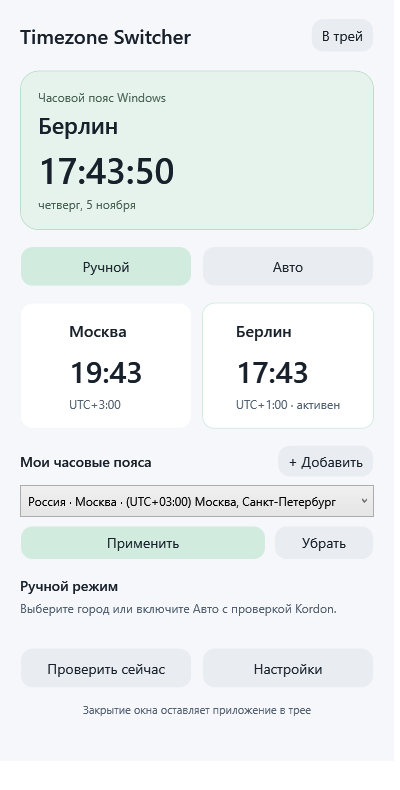

# TimeZone Switcher от AI Terpila

Компактные часы и переключатель часовых поясов для Windows 11. **Версия 1.0.5.**



## Скачать и установить

[Установщик и README на Google Диске](https://drive.google.com/drive/folders/1WChWA6WpmdLX1HJXuM12LD8wklGJIiBt)

Запустите `TimezoneSwitcher-Setup-1.0.5.exe`. Для обновления используйте ту же папку установки: пользовательские настройки сохраняются. Закройте прежнюю копию через «Выход» в трее, если установщик попросит. Доступны Windows x64, установка без повышения прав, необязательные автозагрузка и ярлык на рабочем столе.

В установщике можно снять галочку «Установить Kordon». Если Kordon уже найден, он не заменяется. Если отсутствует и выбран, установщик скачивает официальную версию 1.4.2 с GitHub и сверяет закреплённую SHA-256. Бинарный файл Kordon не распространяется в этом репозитории. Его первоначальная настройка выполняется отдельно.

## Ручной режим

- Быстрый выбор Москвы или Берлина.
- **«+ Добавить»**: каталог установленных часовых поясов Windows с поиском города, региона или названия пояса. Для популярных стран добавлены русские поисковые названия.
- Несколько избранных поясов, сохранение между запусками, выбор из окна или трея.
- **«Применить»** меняет пояс Windows и включает ручной режим. **«Убрать»** удаляет только запись из избранного.
- Добавление в избранное само по себе не меняет системное время. В одной стране может быть несколько поясов; один пояс может использоваться несколькими странами.
- Правила летнего времени берутся из Windows. Ручной выбор имеет приоритет до включения Авто.

## Авто с Kordon

Программа читает локальный статус Kordon, сверяет внешний IP, страну и IANA-регион по ipwho.is и ipapi.co, проверяет маршруты и повторяет подтверждение через 3 секунды. Сам сетевой запрос занимает дополнительное время.

При недоступном интернете выбирается Москва. При неоднозначной маршрутизации, split tunneling или несогласованных ответах пояс сохраняется. Системный прокси/PAC также может препятствовать подтверждению. Регулярная проверка — примерно раз в 2 минуты и после событий сети. Для Авто требуется работающий совместимый Kordon 1.4.x; ручной режим работает самостоятельно.

Показывает двое часов, работает в трее, уведомляет о смене пояса. Закрытие окна оставляет программу в трее; завершение — пункт «Выход».

## Данные и ограничения

Для Авто внешний IP, включая IPv6 при его наличии, передаётся ipwho.is и ipapi.co. Проверка доступности сети использует Microsoft и Cloudflare. Настройки и журнал хранятся локально в `%LOCALAPPDATA%\TimezoneSwitcher`.

Программа меняет часовой пояс стандартной утилитой Windows `tzutil` и отправляет уведомление Windows об изменении. Она не меняет VPN, не подменяет IP и не гарантирует защиту аккаунтов от блокировок. Kordon — самостоятельный сторонний проект. Автоматическое определение пояса Windows может конфликтовать с переключателем.

## Сборка из исходников

Требуются Windows с .NET Framework 4.x и встроенным компилятором C#. Никакие NuGet-зависимости не загружаются.

```powershell
powershell.exe -NoProfile -File .\Build.ps1
```

Используйте разрешённый вашей политикой запуск локальных скриптов; отключать защиту Windows не требуется. Для сборки установщика откройте `installer/Setup.iss` в Inno Setup 6. Выходной установщик создаётся на уровень выше корня проекта.

## Проверки

52 теста логики и WPF smoke test пройдены. Проверяются избранные пояса, сохранение ручного выбора, дробные смещения, приоритет ручного режима, противоречивые ответы сети и маршрутов. Отчёты — в `verification/`.

```powershell
Start-Process .\TimezoneSwitcher.exe -ArgumentList '--self-test', 'tests.txt' -Wait
Start-Process .\TimezoneSwitcher.exe -ArgumentList '--smoke-test', 'ui-test' -Wait
```

Эти проверки используют имитацию изменения пояса и не меняют часовой пояс или автозагрузку Windows. Реальное переключение всех VPN и всех регионов не тестировалось.

## Структура

- `src/App.cs`, `src/Main.xaml` — WPF-окно, настройки и трей.
- `src/Core.cs` — сетевые проверки, политика Авто и каталог поясов.
- `src/Tests.cs` — автономные тесты.
- `src/windowsZones.xml` — соответствия IANA/Windows из Unicode CLDR.
- `assets/` — встроенные иконки.
- `installer/Setup.iss` — установщик.

## Сторонние компоненты

Данные Unicode CLDR распространяются по лицензии в `src/CLDR-LICENSE.txt`.

[Kordon: официальный сайт](https://efimovdev.ru/kordon/) · [Официальные выпуски Kordon](https://github.com/ef1m03/kordon/releases)

Автор проекта TimeZone Switcher: **AI Terpila**. Публичная публикация исходников не заменяет отдельную лицензию на их использование; лицензия проекта пока не выбрана.
